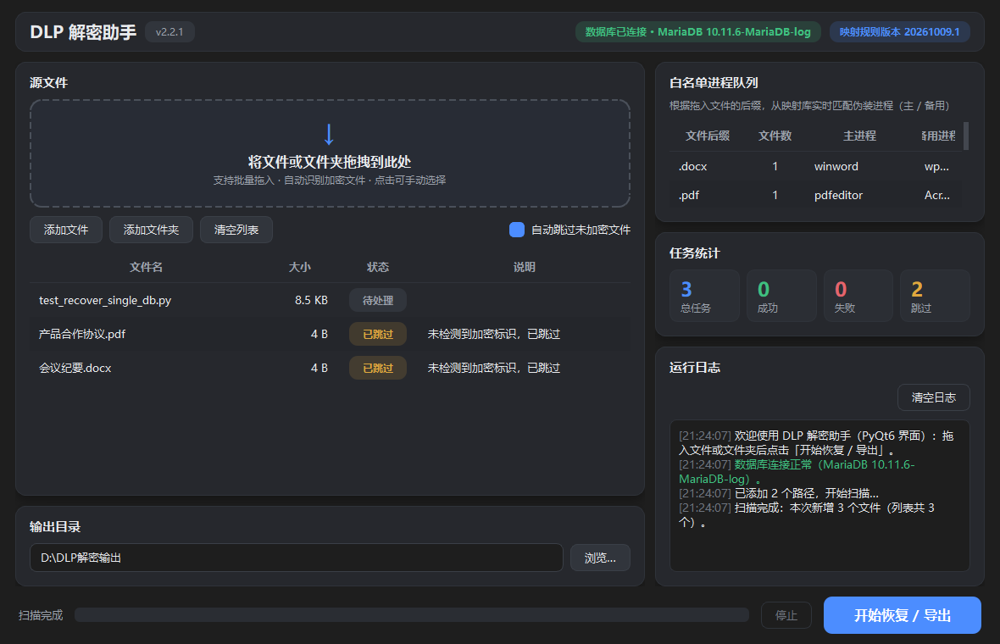

# DLP-Pass

> **⚠️ 用途声明（请务必阅读）**
>
> 本工具面向**自有或已获授权的企业 DLP（数据防泄漏）透明加密环境**，用于将已加密文件
> 批量恢复为明文（如：离职交接、资料归档、系统迁移、日常取数）。
> 请仅在**你有权处置这些文件**的场景下使用，并遵守所在组织的保密制度与当地法律法规。
> **严禁用于任何未经授权的场景。**

DLP-Pass 是一个**完全离线**的 Windows 桌面工具：把被 DLP 客户端透明加密的文件批量恢复为明文。
拖入文件 / 文件夹即可——自动识别加密状态、匹配导出进程、校验导出结果。

本仓库为开源实现（GPLv3）：**源码即发布内容，不含任何代码加密或混淆**；
程序不连接任何数据库、不发起任何网络请求。你可以审计每一行代码，也可以自行构建发布物。

## 界面预览



## 下载预构建版本

绿色单文件可执行程序发布于
[RealfuRyZ/DLP-Pass-Release](https://github.com/RealfuRyZ/DLP-Pass-Release)（含 SHA256 校验值）：

| 文件 | 适用系统 | 技术栈 |
| --- | --- | --- |
| `DLP-Pass.exe` | Windows 10 / 11（64 位） | Python 3.14 + PyQt6 |
| `DLP-Pass-Win7.exe` | Windows 7 SP1 ~ 11（64 位） | Python 3.8 + PyQt5 |

当然，你也可以按「构建发布」一节自行打包，产物完全等价。

## 工作原理

企业 DLP 客户端对文档做**透明加密**：受信任进程读取文件时由驱动自动解密，
不受信任进程（包括普通脚本 / 打包程序）读到的则是带 `%TSD-Header-###%`
标识的密文容器。DLP-Pass 的恢复流程：

1. **读取明文**：优先用当前 Python 进程直接读取（DLP 白名单内时驱动自动解密；
   打包产物不在白名单时自动委派 `cmd.exe` 等系统进程读取）；
2. **匹配伪装进程**：按 `mappings/` 映射表把文件后缀匹配到一组 DLP 白名单进程名
   （如 `.docx -> winword, wps, kwps`）；
3. **伪装落盘**：释放对应进程名的模板 exe，将明文经 stdin 写入 `*.pass` 临时文件，
   再重命名为目标文件——驱动按白名单进程放行，落盘即为明文；
4. **密文校验**：用 PowerShell（非白名单视角）检查输出文件头，确认不含密文标识，
   失败则依次尝试备用进程。

> 前提：源文件与程序运行在**同一套 DLP 策略环境**内；换机器/换环境无法解密属正常现象，
> 请联系你的 DLP 管理员。

## 功能特性

- 拖拽文件 / 文件夹批量解密，保留原有目录结构，自动跳过未加密文件
- 现代化深色界面：任务列表、实时日志、进度条、状态徽标与统计卡片（PyQt6 / PyQt5 双绑定同一套代码）
- 自动密文检测与导出结果校验（确保最终输出为明文）
- 版本化本地映射数据（`mappings/` 目录，启动时始终读取最新版本，改映射无需重装）
- 单文件绿色版：内置全部运行环境，无需安装 Python

## 项目结构

```text
DLP-Pass/
├── main.py                  # 程序入口（启动界面 / --selftest 自检）
├── dlp_pass/
│   ├── config.py            # 应用配置与内置兜底映射规则
│   ├── core/                # 解密业务逻辑（与界面完全解耦，可独立复用）
│   │   ├── mapping_loader.py    # mappings/ 版本化映射加载（取最新版）
│   │   ├── decrypt_service.py   # 解密主流程：读取 -> 伪装落盘 -> 校验
│   │   ├── source_reader.py     # 明文读取（含委派白名单进程）
│   │   ├── verifier.py          # 密文检测（PowerShell 非白名单视角）
│   │   ├── writer_factory.py    # 伪装进程模板释放与复用
│   │   ├── writer_stub.py       # 伪装进程模板源码（独立打包为 exe）
│   │   ├── file_collector.py    # 目录遍历与无关目录剪枝
│   │   └── bundle.py models.py  # 打包资源定位 / 数据结构
│   └── ui_qt/               # Qt 深色界面
│       ├── qt_compat.py         # PyQt6/PyQt5 绑定兼容层
│       ├── app.py               # 应用装配、日志、--selftest
│       ├── main_window.py       # 主窗口与交互流程
│       ├── widgets.py theme.py  # 自定义控件 / 主题样式
│       └── workers.py           # QThread 后台任务（扫描 / 批量解密）
├── mappings/                # ★ 映射数据：每文件一个版本（见目录内 README）
├── packaging/               # 构建脚本与发布说明
├── tests/                   # 单元测试（标准库 unittest，无第三方依赖）
├── assets/                  # 文档图片
├── requirements.txt         # 运行/开发依赖（现代版）
└── LICENSE                  # GPLv3
```

## 映射数据（mappings/）

「文件后缀 -> 白名单伪装进程」的对应关系存放于 [`mappings/`](./mappings/README.md)：

- 每个 JSON 文件即一个版本，文件名即版本号（如 `20261009.1.json`）；
- **程序启动时始终读取版本号最大的文件**作为当前生效映射（无需重装/重新构建）；
- 目录查找优先级：`config.json` 的 `mappings_dir` -> exe 同目录 `mappings/` ->
  随包内置 `mappings/` -> 项目根 `mappings/`；
- 找不到任何映射时使用内置兜底规则（`.pdf -> pdfeditor`，其余 -> `notepad, winword, wps`）。

## 配置（可选）

程序**零配置即可运行**。如需调整，在 exe 同目录（或项目根）放置 `config.json`：

```json
{
    "powershell_timeout": 10.0,
    "default_output_dir": "D:/解密输出",
    "mappings_dir": "D:/my-mappings"
}
```

| 字段 | 说明 | 默认值 |
| --- | --- | --- |
| `encryption_marker` | 密文容器标识串 | `%TSD-Header-###%` |
| `powershell_timeout` | 密文校验超时（秒） | `10.0` |
| `default_output_dir` | 界面初始输出目录 | 桌面/`DLP解密输出` |
| `mappings_dir` | 显式指定映射目录 | 空（自动查找） |
| `writer_cache_dir` | 伪装进程模板缓存目录 | `%TEMP%/dlp_pass_writers` |
| `python_executable` | 明文读取委派的 python 路径 | 空（自动探测） |

> 旧版基于 MariaDB 的集中映射与解密审计已在开源重构（v2.3.0）中**整体移除**，
> 程序不再有任何网络行为。

## 快速开始（源码运行）

```bat
python -m venv .venv
.venv\Scripts\activate
pip install -r requirements.txt
python main.py            :: 启动界面
python main.py --selftest <加密文件>   :: 无界面自检（退出码 0=成功）
```

## 构建发布

```bat
:: 现代版（Windows 10/11）—— 主虚拟环境
.venv\Scripts\python.exe packaging\build_exe.py

:: Win7 兼容版（Windows 7 SP1+）—— 需要 Python 3.8 专用虚拟环境
E:\Python38\python.exe -m venv .venv38
.venv38\Scripts\python.exe -m pip install -r packaging\requirements-win7.txt
.venv38\Scripts\python.exe packaging\build_exe_win7.py
```

两条流水线均为标准 PyInstaller 单文件打包，**不做任何代码加密/混淆**；
构建输出包含产物 SHA256，可直接用于发布说明。

## 开发约定

- **双解释器兼容**：核心与界面代码必须同时在 Python 3.8（Win7 构建链）与最新
  Python（开发环境）下可运行；文件顶部保留 `from __future__ import annotations`，
  避免使用 3.9+ 才有的语法/标准库 API。
- **Qt 绑定兼容**：界面只从 `ui_qt.qt_compat` 导入 Qt 名字；PyQt6 与 PyQt5 5.15
  均支持作用域枚举写法（如 `Qt.AlignmentFlag.AlignCenter`），无需分叉代码。
- **core 与界面解耦**：`dlp_pass.core` 不导入任何 Qt/界面代码，可独立测试与复用。
- 中文文档字符串 + 完整类型注解；公开 API 的行为约定写入 docstring。
- 运行测试：`python -m unittest discover -s tests -v`（两个虚拟环境都应通过）。

## 隐私与安全

- 完全离线：无数据库、无任何网络请求（可自行核验依赖清单）；
- 代码明文打包进发布物（标准 PyInstaller），可反编译审计——这正是开源的意义；
- 日志与解密过程只写入本机（`%LOCALAPPDATA%\DLP-Pass\logs`）。

## 常见问题

- **Windows 7 提示 `python314.dll` / `LoadLibrary 找不到指定的模块`** —— 那是现代版
  （Python 3.14/Qt6 要求 Win10+）；Win7 请用 `DLP-Pass-Win7.exe`。
- **顶部徽标显示「映射规则 内置兜底」** —— `mappings/` 目录缺失或内容不可用，
  核心解密仍可用（兜底规则），按目录内 README 补充即可。
- **导出后校验仍为密文** —— 当前 DLP 策略未信任所使用的伪装进程名，
  请换用/增补白名单进程映射（见 `mappings/README.md`）。
- **首次启动稍慢** —— 单文件程序首次运行需解压运行环境（数秒），属正常。

## 许可

本项目以 **GNU GPLv3** 许可发布（见 [LICENSE](./LICENSE)）。
注意：PyQt6/PyQt5 本身为 GPL 许可，分发含 PyQt 的二进制需遵守 GPL 条款。
